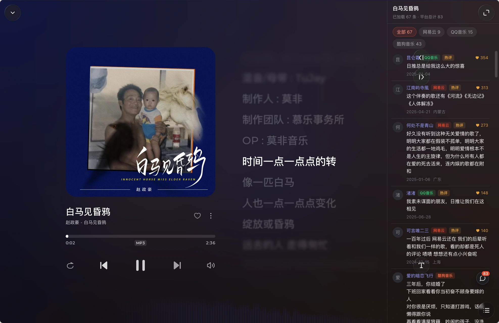
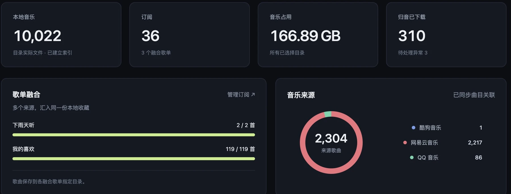
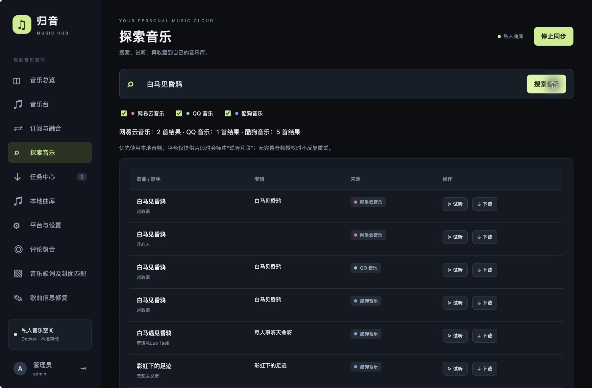
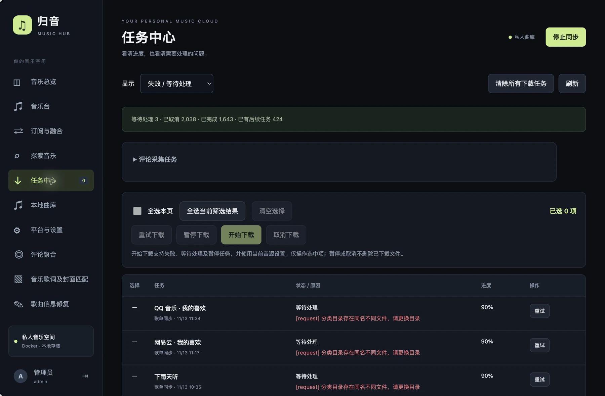
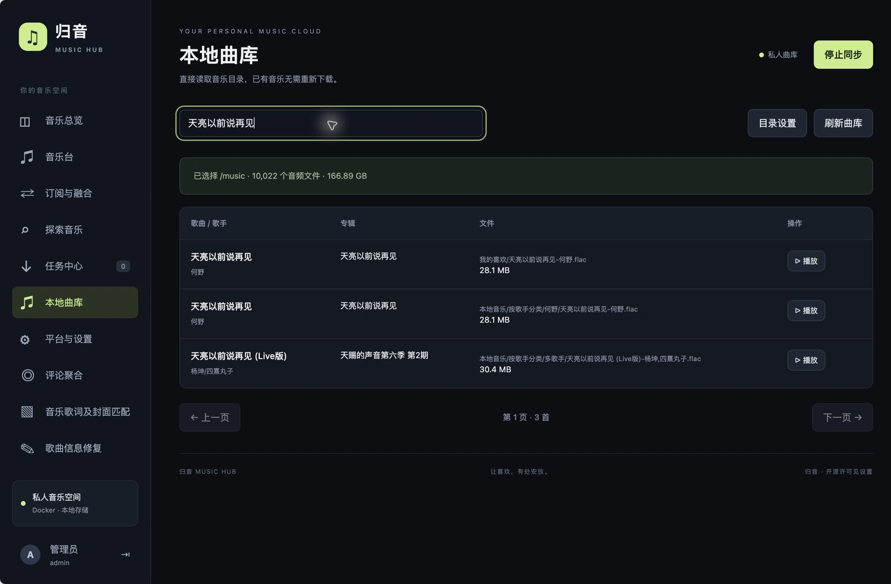
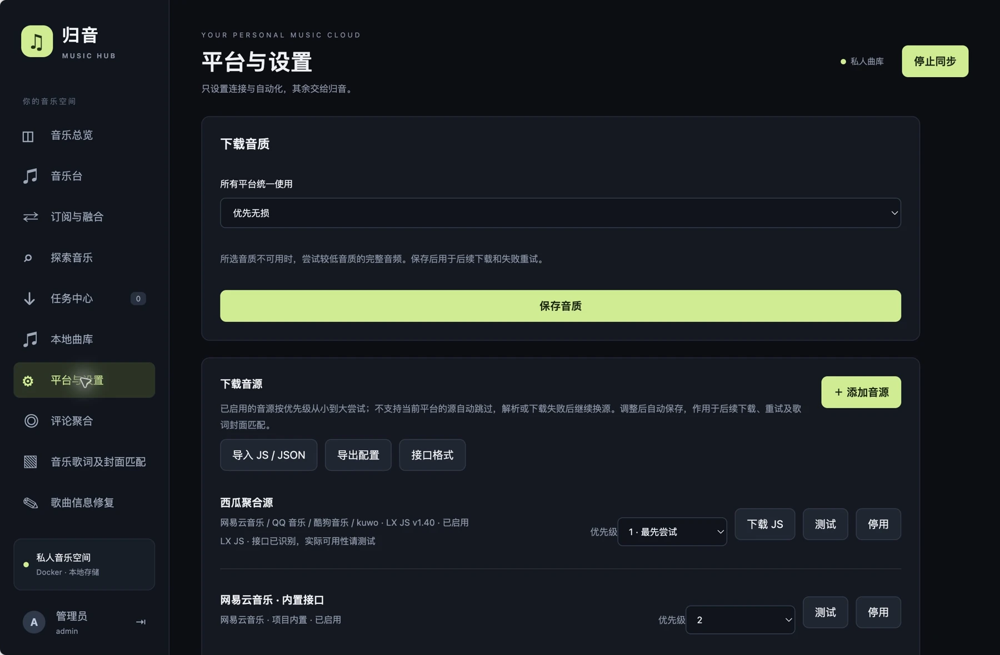
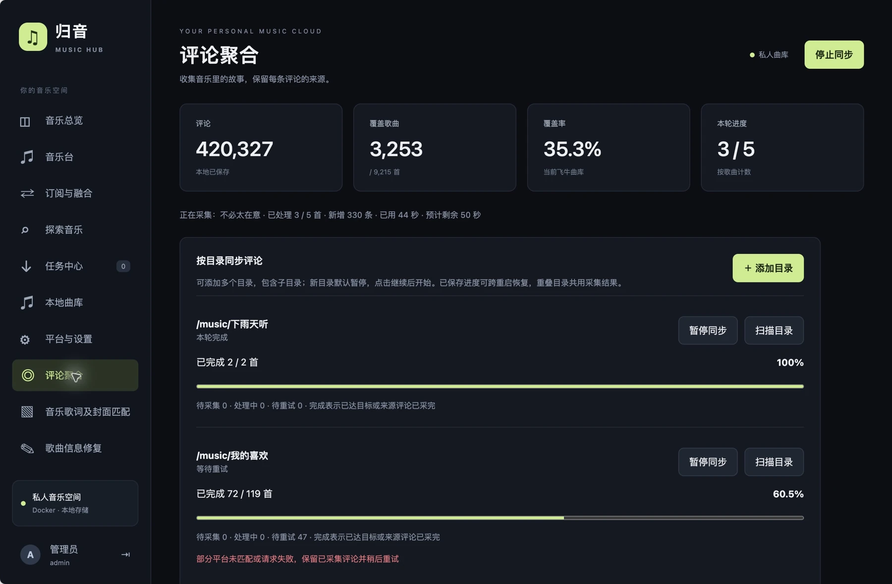
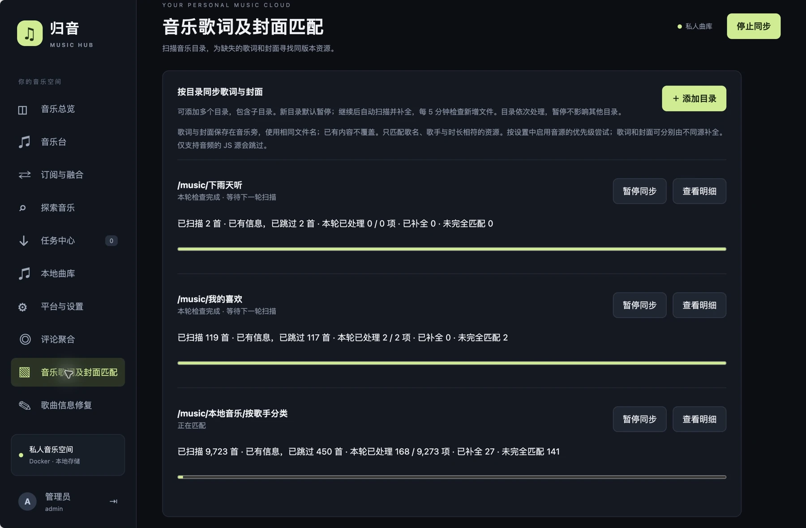
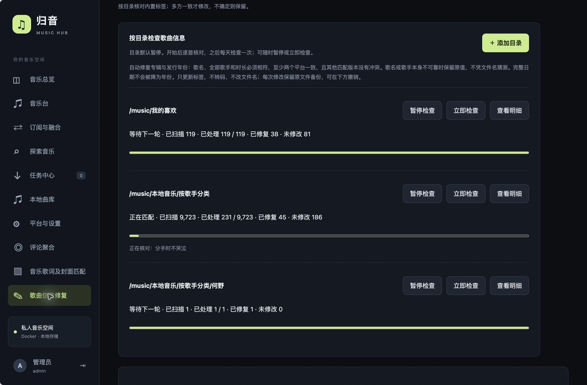
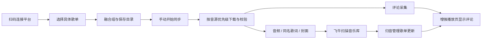

<div align="center">


# 归音 · Guiyin Music Hub

**让喜欢，有处安放。**

把多平台歌单、NAS 音乐文件、歌词封面和评论，放进同一套音乐库工作流。

[功能展示](#功能展示) · [安装部署](#安装部署) · [使用手册](docs/USAGE.md) · [常见问题](docs/FAQ.md) · [更新记录](CHANGELOG.md)


</div>

归音是面向 **飞牛 fnOS** 的单容器私人音乐库工具。选择网易云音乐、QQ 音乐、酷狗的歌单，融合到指定文件夹；归音负责订阅、下载、资源补全与评论采集，飞牛音乐负责音乐库和播放体验。

### 听歌时，让评论也在场



*项目作者提供的实际效果图。播放、封面、歌词及播放控制由飞牛音乐页面提供，右侧评论由归音增强层展示，支持按来源查看。此功能面向增强网页，不是修改飞牛原生客户端安装包。*

## 功能一览

| 功能 | 你可以做什么 |
| --- | --- |
| 音乐总览 | 查看本地音频数、空间占用、订阅、下载活动、平台来源和评论统计 |
| 平台账号 | 扫码连接网易云、QQ 音乐、酷狗，发现喜欢、创建和收藏的具体歌单 |
| 订阅与融合 | 勾选需要的来源，多个平台汇入一个文件夹；目录可浏览选择，新建融合需指定保存位置 |
| 分类下载 | 仅处理选中来源；音频、同名歌词和封面落到对应目录，下载校验后再发布文件 |
| 飞牛歌单 | 入库后核对并维护归音管理的原生歌单，保留干净名称，按来源顺序选取首个可用封面 |
| 音乐台 | 在新标签页打开飞牛音乐增强页面，并尽量复用已打开的归音音乐台窗口 |
| 探索音乐 | 多平台搜索、试听和加入下载任务；区分本地音频、完整音频与试听片段 |
| 任务中心 | 分页、总页数、多选、全选筛选结果、重试、暂停、开始、取消及清除下载任务记录 |
| 本地曲库 | 扫描已有音乐，查看歌名、歌手、专辑、文件路径和大小，筛选并播放 |
| 下载音源 | 添加 HTTP 接口，导入 JSON / LX JS，测试、停用、导出及调整优先级，失败时尝试下一个适用源 |
| 评论聚合 | 网易云、QQ 音乐、酷狗评论按歌曲汇总，保留作者与来源；目录独立暂停、继续和进度恢复 |
| 歌词与封面 | 按目录补全缺失资源，使用启用源辅助匹配；已有信息自动跳过并显示完成进度 |
| 歌曲信息修复 | 按目录保守核对专辑和发行年份，多平台一致才写入标签；保留原文件备份和撤销记录 |

## 功能展示

以下为 **0.9.21-r1 实际运行界面**，已裁去浏览器信息及账号区域。统计数字是截图时的实例数据，安装后从自己的曲库开始。展示图中的个人导入音源不随项目分发。

### 01 · 音乐总览

本地文件统计与平台歌曲关联分开计算，快速查看自己的音乐收藏和融合进度。



### 02 · 订阅与融合

例如把网易云和 QQ 的“我的喜欢”勾选到同一融合组，统一保存至 `/music/我的喜欢`；“下雨天听”使用独立目录。未勾选的收藏夹不下载，先配置目录，再开始同步。


### 03 · 跨平台搜索与试听

一次搜索对照多个平台的版本、歌手和专辑，再决定试听或下载。



### 04 · 下载任务管理

失败原因、音源尝试过程与任务状态可追踪；批量选择跨页保留，切换筛选时清空。暂停、取消和清除记录均不删除已下载音乐。



### 05 · 本地曲库

直接读取所选音乐目录。图中普通版与 Live 版分开保留，不仅凭同名认作同一首。



### 06 · 音源优先级与自动切换

内置和自定义源一起按优先级使用。只有支持当前平台的源会被尝试；解析、传输或完整性校验失败后继续换源。设置变更用于后续任务与重试。



### 07 · 按目录聚合评论

每个目录可单独继续、暂停或扫描，显示已完成、待采集、处理中及待重试数量。新下载歌曲也会安排评论采集。



### 08 · 按目录补全歌词和封面

歌词与封面保存在音频旁，使用相同文件名；支持的音频格式还会写入封面标签。已有内容不覆盖，已有信息跳过时明确计数，检查完成显示满格进度。



### 09 · 保守修复歌曲信息

歌名、完整歌手集合和时长匹配后，至少两个平台对字段达成一致才自动修复专辑或年份。有版本冲突、证据不足或文件正在变化时保留原值；修改前备份完整文件，支持撤销。



## 工作流程



目录补全和信息修复也适用于已经存放在 NAS 上的音乐，不要求这些文件由归音下载。

## 安装部署

### 环境

- 已安装飞牛音乐的 fnOS NAS，以及 Docker / Compose。
- 可读写的音乐目录、可写的数据目录，以及飞牛音乐 socket 和只读数据库目录挂载。
- 单个应用实例、单个 Uvicorn worker。接口兼容性受飞牛音乐版本与上游平台变化影响。

### 飞牛 Docker 直接安装（无需构建）

镜像：**`ghcr.io/wwwwwwjy/guiyin:latest`**，适用于 **linux/amd64（Intel / AMD）**。默认跟踪最新发布；如需固定版本，可在 `.env` 中设置 `GUIYIN_IMAGE_TAG=0.9.22`。镜像内已安装依赖，不需要给 NAS 安装 Python 或 Node。

1. 在飞牛文件管理中创建归音数据目录，并确认音乐目录已经存在。
2. 下载本仓库的 [compose.yaml](compose.yaml) 和 [.env.example](.env.example)，放在 NAS 的同一项目目录下，将 `.env.example` 改名为 `.env`。
3. 编辑 `.env`，填写自己的管理员密码和实际路径：

   ```dotenv
   BRIDGE_ADMIN_PASSWORD=替换为你自己的至少12位密码
   NAS_MUSIC_DIR=/vol1/1000/Music
   HUB_DATA_DIR=./data
   HUB_PORT=8600
   FNMUSIC_SOCKET_PATH=/run/trim_music.socket
   FNMUSIC_FNDB_DIR=/usr/local/apps/@appdata/trim.music/db
   ```

4. 打开 **飞牛 Docker → Compose → 新增项目**，选择上述项目目录和 `compose.yaml`，创建并启动。该配置直接拉取镜像，没有 `build` 步骤，也无需下载完整源码。
5. 打开 `http://NAS_IP:8600`，使用账号 `admin` 和自己设置的密码登录。
6. 在“平台与设置”选择飞牛账号，把对应音乐文件夹加入飞牛音乐媒体库；扫码连接音乐平台，读取歌单，设置来源与保存目录，再开始同步。

`/vol1/1000/Music` 只是示例，请使用文件管理中的真实路径。飞牛音乐必须已安装并运行；socket 和数据库位置不同的安装环境应修改对应变量。数据库以只读方式挂载。不要把 socket 文件误建成文件夹。

也可以在飞牛 Docker 镜像页拉取 `ghcr.io/wwwwwwjy/guiyin:latest`，然后按 Compose 中的端口、环境变量与挂载创建容器。GHCR 公开镜像无需登录；拉取超时时先检查 NAS 到 `ghcr.io` 的网络连接。

| 宿主机位置 | 容器位置 | 用途 |
| --- | --- | --- |
| `NAS_MUSIC_DIR` | `/music` | 已有音乐与融合目录，需读写 |
| `HUB_DATA_DIR` | `/data` | 登录凭据、订阅、任务、评论、源配置及修复备份 |
| `FNMUSIC_SOCKET_PATH` | `/run/trim_music.socket` | 飞牛音乐接口连接 |
| `FNMUSIC_FNDB_DIR` | `/fndb`（只读） | 核对文件路径、曲目及账号可见性 |

网页目录浏览只能访问 Docker 已挂载的位置。ARM 设备暂未发布验证镜像。普通电脑可使用 `compose.local.yaml` 构建并验证独立界面，但没有飞牛原生歌单和增强播放连接。

### 命令行安装与升级

将上述两个配置文件放在同一目录，配置 `.env` 后执行：

```bash
docker compose pull
docker compose up -d
```

升级前备份数据目录。跟踪 `latest` 时，直接在飞牛 Docker 拉取镜像并重新创建容器；使用固定版本时，先修改 `GUIYIN_IMAGE_TAG`。若飞牛 Docker 提供镜像更新检查，可在 Docker 中启用；归音设置页只显示运行版本。保留原来的环境变量和挂载；不要删除数据目录或音乐目录。回退时固定到原镜像版本并恢复相应的数据备份。歌曲信息修复备份位于 `/data/metadata-backups`。

### 开发者源码构建

```bash
git clone https://github.com/wwwwwwjy/Guiyin.git
cd Guiyin
cp .env.example .env
# 配置 .env 后：
docker compose -f compose.build.yaml up -d --build
```

镜像发布由 [GitHub Actions](.github/workflows/docker-publish.yml) 完成：构建时运行回归测试，启动健康检查成功后再推送 GHCR。构建流程使用 GitHub 临时令牌，源码和镜像不包含部署者账号、密码、数据库或私人音源。

## 行为与限制

- 同步按周期检查，并非手机端实时推送。只有完整读取歌单后才更新来源快照；分页失败和登录失效不会被当成删除。
- 取消来源或停止订阅会停止相应同步，已下载音频保留。飞牛扫描完成前，文件数量与歌单数量可能暂时不同。
- 音源测试只证明本次测试可用，不能保证所有歌曲均可下载。平台账号权限、地区、版权、接口可用性和限流都可能影响结果；已识别的试听片段不作为完整歌曲保存。
- JS 导入支持项目实现的 **LX 协议适配子集**，并非所有任意 JS 插件。只提供音频解析的源不能用于补全歌词或封面。详见 [音源接口说明](app/sources/README.md)。
- 评论“完成”表示达到采集目标或来源已采完，不代表全网评论全部收齐。保留已采集结果，失败项目继续等待重试。
- 信息修复采用保守策略，目前自动修改 **专辑与发行年份**。歌名或歌手不可靠时不自动猜测；多平台数据也无法保证绝对无误，因此保留备份和撤销能力。
- 只使用自己有权访问和保存的内容。项目不附带平台账号、登录凭据、音乐文件或用户私有音源。

更多操作说明和排错方式见 [使用手册](docs/USAGE.md) 与 [常见问题](docs/FAQ.md)。

## 开发与贡献

源代码、测试、Docker 构建文件和第三方许可一起提供。最近的 NAS 镜像构建通过 199 项 Python 回归测试；这不代表外部音乐服务永远可用。

```bash
python -m unittest discover -s tests -p 'test_*unittest.py'
node --check app/static/studio.js
node tests/test_asset_directories.js
python tools/package_release.py --audit-only
```

[贡献指南](CONTRIBUTING.md) 说明本地开发、测试及提交问题需要的信息。请勿在 Issue 或 PR 中提交 Cookie、二维码登录票据、管理员密码、数据库和私人源文件。

## 请作者喝一杯咖啡

如果归音帮你整理好了音乐库，可以在应用 **平台与设置最底部** 点击 **“请作者喝一杯咖啡”**。弹窗分别展示项目作者的支付宝与微信收款码；默认不展示二维码，打赏完全自愿。两张二维码采用相同尺寸与留白，保留原二维码中央标识，不展示外围店铺名称。

## 来源与许可

归音使用 GPL-3.0-or-later，保留实际使用的开源组件许可和原作者署名，包括 [FnMusic Bridge](https://github.com/baimoushare/fnmusic-bridge)、[Netease_url](https://github.com/Suxiaoqinx/Netease_url)、[KuGouMusicApi](https://github.com/MakcRe/KuGouMusicApi) 及 QQMusicApi。参考 [柠檬音乐](https://github.com/jia070310/lemon-muisc) 的音源适配模式。归音不是这些项目的官方版本。

具体修改、参考范围和许可文件位置见 [THIRD_PARTY_NOTICES.md](THIRD_PARTY_NOTICES.md)。QQMusicApi 对应版本源码随发行包保留在 `third_party`，其余许可和来源记录位于 `licenses`。
